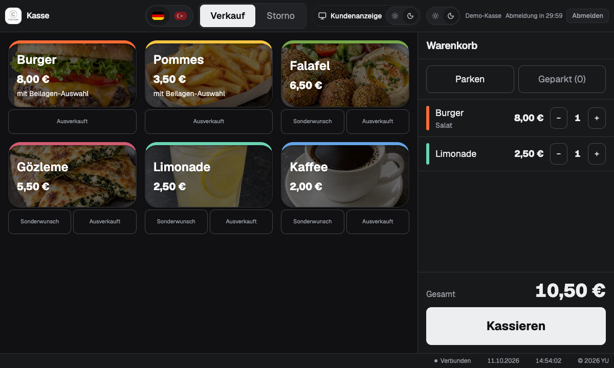
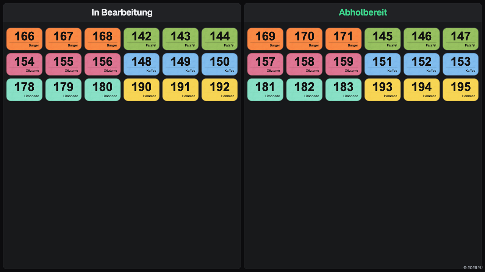
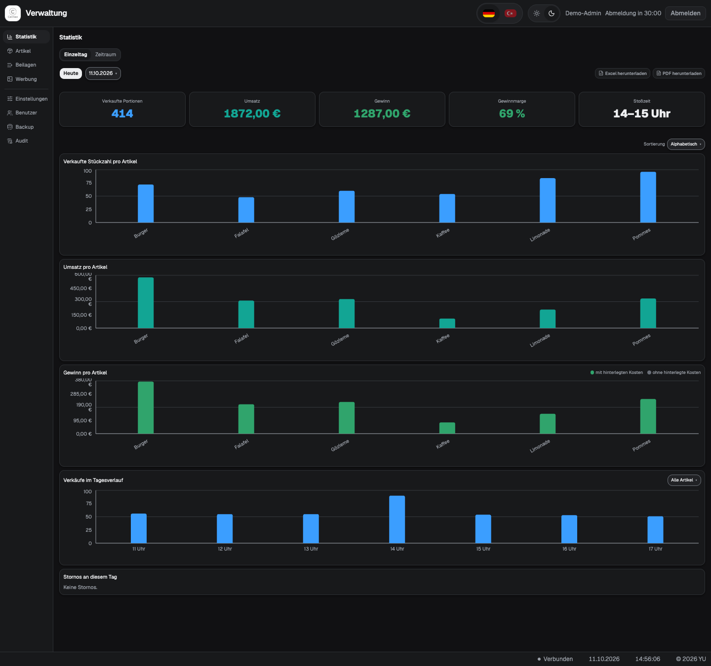

# Cermes

**Verkauf, Küche und Ausgabe für Vereinsfeste. Lokal im Browser, ohne Internet im Betrieb.**

[English](README.en.md) · [Bedienungsanleitung](ANLEITUNG.md) · [Lizenz](LICENSE)

Cermes verbindet Kasse, Küche, Ausgabe und Kundenanzeigen in einem lokalen Netzwerk.
Jede verkaufte Portion erhält eine eigene Abholnummer. Die Küche meldet sie als fertig,
die Ausgabe bestätigt die Abholung und der Fernseher zeigt den aktuellen Stand.
Ein Laptop mit Docker genügt als Server; die anderen Geräte benötigen einen Browser.

## Aus der Praxis

Das Projekt entstand für wiederkehrende Vereinsverkäufe und wird dort regelmäßig
eingesetzt. Mit einer Kasse werden pro Verkaufswochenende ungefähr **10.000 € Umsatz**
abgewickelt. Diese Größenordnung beschreibt den tatsächlichen Einsatz, keinen Lasttest.

Entwickelt von **Yakub Uyar**. Der Quellcode macht die Umsetzung und ihre
Grenzen nachvollziehbar.

## Einblicke

Die drei Aufnahmen zeigen die deutsche Oberfläche mit erfundenen Beispieldaten
und Artikelbildern zur Veranschaulichung.
Sie enthalten keine echten Verkaufsdaten, Vereinslogos oder Werbeinhalte.

### Kasse

Artikel, Beilagen, Sonderwünsche und Warenkorb in einer Ansicht.



### TV-Anzeige

Abholnummern werden nach „In Bearbeitung“ und „Abholbereit“ getrennt angezeigt.
Die Überschriften wechseln im Betrieb automatisch zwischen Deutsch und Türkisch.



### Statistik

Stückzahlen, Umsatz, kalkulierter Gewinn und Auswertungen nach Artikel und Uhrzeit.



## Funktionen

- Kasse mit Beilagen, Sonderwünschen, geparkten Warenkörben und Storno
- Eigene Nummernkreise und konfigurierbare Nummernblöcke pro Artikel
- Getrennte Ansichten für Küche und Ausgabe mit Live-Aktualisierung
- TV-Anzeige, Werbekarussell und Kundenanzeige an der Kasse
- Statistik für einzelne Tage und Zeiträume, Export als Excel und PDF
- Verwaltung von Artikeln, Beilagen, Bildern, Benutzern und Einstellungen
- Rollenrechte auf dem Server und Audit-Protokoll
- Backup als ZIP herunterladen und nach Prüfung wieder einspielen
- Deutsche und türkische Oberfläche, dunkles und helles Design
- Unterstützung mehrerer Kassen mit eigener Kundenanzeige; im beschriebenen
  Praxiseinsatz wird eine Kasse verwendet

## Technik und Entscheidungen

| Bereich | Umsetzung und Grund |
| --- | --- |
| Oberfläche | React, Vite und Tailwind CSS; Geräte arbeiten ohne App-Installation im Browser. |
| Server | Node.js 22 und Express; API und gebaute Oberfläche laufen zusammen. |
| Datenbank | SQLite mit WAL und Wartefrist bei Schreibzugriffen; kein zusätzlicher Datenbankserver. |
| Live-Updates | WebSocket-Ereignisse stoßen das Nachladen der betroffenen Ansichten an. |
| Geld | Ganze Cent-Beträge statt Fließkommazahlen für Preise und Summen. |
| Buchungen | Nummernvergabe und Verkauf werden in einer Transaktion gespeichert. |
| Historie | Namen, Preise und Kosten werden beim Verkauf eingefroren; spätere Artikelpflege verändert vergangene Verkäufe nicht. Storno ist eine Statusänderung. |
| Berechtigungen | Der Server prüft die Rollen; ausgeblendete Schaltflächen sind kein Zugriffsschutz. |
| Betrieb | Ein Docker-Container, Port 8080 und ein Datenordner; Schriften und Bibliotheken werden lokal ausgeliefert. |

Die Anwendung ist für ein vertrauenswürdiges lokales Netzwerk vorgesehen. Der Server
muss erreichbar sein: Internetfreiheit bedeutet nicht, dass Geräte ohne Verbindung
zum Server Verkäufe buchen können. Cermes erfasst Verkäufe; es verarbeitet keine
Kartenzahlungen und druckt keine Kassenbons. Eine öffentliche Internet-Demo gehört
nicht zum vorgesehenen Betrieb.

## Lokal starten

Voraussetzung: Docker mit Docker Compose, beispielsweise Docker Desktop.
Beim ersten Build ist Internet zum Herunterladen der Abhängigkeiten nötig.

```sh
git clone https://github.com/Yakub-Tech/Cermes.git
cd Cermes
```

1. `.env.beispiel` kopieren und die Kopie `.env` nennen.
2. Hinter `CERMES_EINRICHTUNGSKENNWORT=` ein eigenes starkes Kennwort eintragen.
   Ohne dieses Kennwort bleibt die Ersteinrichtung gesperrt.
3. Starten:

   ```sh
   docker compose up -d --build
   ```

4. `http://localhost:8080` öffnen und mit dem Einrichtungskennwort das erste
   Admin-Konto anlegen. Andere Geräte verbinden sich über die lokale Adresse
   des Server-Laptops im selben Netzwerk.

Unter Windows helfen `Cermes-Starten.bat` und `Cermes-Beenden.bat` beim täglichen
Betrieb. Details stehen in der [Bedienungsanleitung](ANLEITUNG.md).

```sh
docker compose down     # Beenden; gespeicherte Daten bleiben erhalten
docker compose up -d    # Vorhandenes Image ohne Neubau starten
```

Die Anwendung legt Datenbank, Bilder und Session-Geheimnis in `data/` an.
Dieser Ordner und die Datei `.env` gehören nicht ins Repository. Die Veröffentlichung
enthält weder eingerichtete Konten noch eine gefüllte Verkaufsdatenbank.

## Entwicklung und Prüfungen

Voraussetzung: Node.js 22. Abhängigkeiten werden anhand der Lockdateien installiert.

```sh
npm --prefix backend ci
npm --prefix frontend ci
npm --prefix backend test
npm --prefix frontend test
npm --prefix frontend run build
npm --prefix frontend run pruefe-offline
```

Für die Entwicklung in zwei Terminals:

```sh
npm --prefix backend start
npm --prefix frontend run dev
```

Der Backend-Server läuft auf Port 8080, der Vite-Server auf Port 5173.
Vite leitet API-Anfragen an das Backend weiter. Automatische Tests prüfen unter
anderem Nummernvergabe, Kassieren, Storno, Statistik, Anmeldung, Backup und
Verbindungsabbrüche. GitHub Actions führt Tests, Build und Offline-Prüfung aus.
Die Offline-Prüfung sucht im gebauten Frontend nach externen Adressen.

## Projektstruktur

```text
backend/src/       Express-API, Geschäftslogik und SQLite-Migrationen
backend/test/      Backend- und API-Tests
frontend/src/      React-Ansichten, Komponenten und Hilfsfunktionen
frontend/test/     Tests für Frontend-Logik und Oberflächenregeln
frontend/scripts/ Offline-Prüfung
assets/           Neutrales Standardlogo und Screenshots
data/             Lokale Laufzeitdaten, nicht im Git
```

## Lizenz und Nutzung auf eigene Verantwortung

Copyright © 2026 **Yakub Uyar**. Der öffentlich einsehbare Quellcode wird unter
[eigenen Lizenzbedingungen](LICENSE) bereitgestellt, auf Deutsch und Englisch.

**Kostenlos nutzen, ansehen und anpassen ist erlaubt.** Vereine und Unternehmen
dürfen Cermes als Kasse einsetzen und damit ihre Warenverkäufe erfassen.
**Cermes oder darauf basierende Versionen verkaufen oder kostenpflichtig anbieten
ist ohne ausdrückliche Erlaubnis von Yakub Uyar untersagt.** Auch kostenpflichtiger
Zugang, kostenpflichtige Softwaredienste und entsprechende Einbindungen in andere
Softwareangebote sind untersagt. Kostenlose Weitergabe ist mit Quellcode, Lizenz
und Urheberhinweisen erlaubt. Fremde Bibliotheken behalten ihre eigenen Lizenzen.
Cermes ist damit keine Open-Source-Software nach der üblichen Definition.
Die vollständigen Bedingungen stehen in [LICENSE](LICENSE).

**Nutzung auf eigene Verantwortung.** Cermes wird kostenlos in der vorliegenden Form
bereitgestellt, ohne Gewährleistung, zugesicherten Support oder Wartungsverpflichtung,
soweit gesetzlich zulässig. Vor einem produktiven Einsatz müssen die Betreiber den
Code und die Anwendung auf Eignung, Funktionsfähigkeit, Sicherheit, Datenschutz und
die für ihren Einsatz geltenden rechtlichen Anforderungen prüfen. Sie sind für
Betrieb, Zugriffsrechte und Datensicherung verantwortlich. Eine Eignung oder
Rechtskonformität für einen bestimmten Einsatzzweck wird nicht zugesichert.
Für Schäden aus der Nutzung oder Nichtnutzbarkeit wird im gesetzlich zulässigen
Umfang keine Haftung übernommen. Zwingende gesetzliche Haftung bleibt unberührt.
